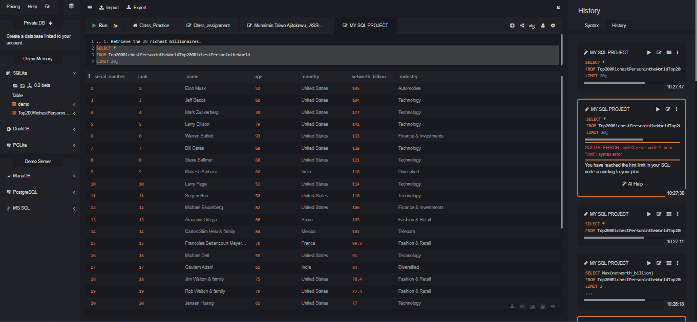

# GLOBAL BILLIONAIRES ANALYSIS

## INTRODUCTION

The **Global Billionaires Analysis** is a SQL-based data analytics project developed to explore the wealth distribution of the world's top 200 richest individuals.
The project examines billionaire wealth across different countries, industries and age groups, providing insights into geographical wealth distribution, industry representation, individual net worth and demographic patterns.
Using SQL, the project transforms structured billionaire data into meaningful insights that help explain how wealth is distributed among the world's wealthiest individuals.

## ABOUT THE DATASET

The Top 200 Richest World's Billionaires Dataset provides a detailed overview of the wealthiest individuals globally, according to the Forbes list. This dataset captures essential information about the top 200 billionaires, offering insights into their financial standing, age, industry, and more. It is a valuable resource for analyzing trends in wealth distribution, industry dominance, and the demographics of the world's richest people. 

The dataset includes:

1. Individual information (name, age and rank).
2. Country of association.
3. Net worth in billions of US dollars.
4. Industry classification.
5. Serial number.

Data source: [Click Here](Top_200_Richest_Person_in_the_World.xlsx)

## Problem Statement

Understanding global wealth distribution requires examining more than individual billionaire rankings. It involves identifying the countries and industries contributing significantly to billionaire wealth and exploring how age, geographical location and industry relate to accumulated wealth.

This project uses SQL to analyse the dataset and answer the following 23 analytical questions:

**A. Individual Wealth Analysis**
1.	Who are the 20 richest billionaires?
2.	Who are the five youngest billionaires?
3.	What are the average age and average net worth of the billionaires?
4.	Which billionaires have a net worth exceeding the overall average?
5.	How many billionaires have a net worth above $50 billion?
6.	Who are the billionaires with a net worth between $50 billion and $100 billion?
7.	What is the difference between the richest and poorest billionaires?

**B. Country-Based Analysis**

8.	Which are the five most represented countries?
9.	What is the combined net worth of billionaires from each country?
10.	Which countries have at least five billionaires?
11.	Which country has the highest combined billionaire wealth?
12.	Which country has the highest average billionaire net worth?
13.	Which country has the highest number of billionaires below age 40?

**C. Industry-Based Analysis**

14.	Which are the five industries with the highest number of billionaires?
15.	Which industry has the highest average net worth?
16.	Which industry has the wealthiest billionaire?
17.	Which industries have at least 10 billionaires?
18.	Which industry contributes the most to the combined wealth of the top 200?
19.	Which billionaires belong to industries with more than 10 representatives?

**D. Age and Wealth Analysis**

20.	What is the total wealth of billionaires younger than 50?
21.	What percentage of the dataset is made up of billionaires younger than 50?
22.	What is the average net worth of billionaires aged above 70?
23.	What is the total wealth of billionaires aged below 50?

Analysed answers of the above problem statement in SQL [Click Here](SQL_queries.sql)

## SQL Analysis and Techniques

The analysis involved the application of the following SQL techniques:

a. Data Retrieval: SELECT and FROM.

b. Data Filtering: WHERE, BETWEEN and IN.

c. Data Sorting: ORDER BY and LIMIT.

d. Data Aggregation: GROUP BY and HAVING.

e. Aggregate Functions: COUNT(), SUM(), AVG(), MAX() and MIN().

f. Conditional Logic: CASE WHEN.

g. Subqueries: Comparing individual net worth against the overall average and identifying industries based on their representation.

h. Data Formatting: ROUND().

These techniques were used to examine individual wealth, country representation, industry distribution and age-related patterns.

## Key Findings and Insights

A. **Overall Wealth Distribution**

•	The average age of billionaires in the dataset is approximately 69.38 years.

•	The average net worth is approximately $31.84 billion.

•	The combined net worth of the 200 individuals is approximately $6.37 trillion.

B. **Country Representation**

•	The United States recorded the highest number of billionaires, with 79 individuals.

•	China followed with 17, India with 13, while Russia and Germany recorded 11 each.

•	The United States also had the highest combined billionaire wealth, approximately $3,130.9 billion.

C. **Industry Representation**

•	Technology recorded the highest number of billionaires, with 40 representatives.

•	Finance & Investments followed with 32, while Fashion & Retail recorded 30.

•	Technology also contributed the highest combined industry wealth, approximately $1,738.8 billion.

D. **Age and Wealth Distribution**

•	16 billionaires were younger than 50, representing 8% of the dataset.

•	Their combined net worth was approximately $508.3 billion.

•	25 billionaires had a net worth exceeding $50 billion.

E. **Individual Wealth**

•	Bernard Arnault & family ranked first in the dataset, with a net worth of $233 billion.

•	Mark Mateschitz was the youngest billionaire identified, at 31 years old.

•	The difference between the highest and lowest net worth was approximately $222.3 billion.

## Key Recommendations

Based on the analysis, the following observations are worth considering:
1.	**Geographical Wealth Concentration:** The dominance of the United States in billionaire representation and combined wealth highlights the concentration of extreme wealth within particular economies.
2.	**Industry Influence:** Technology's leading position in both billionaire representation and combined wealth demonstrates its significant contribution to the wealth distribution captured in the dataset.
3.	**Industry Comparison:** Comparing the number of billionaires, average net worth and combined wealth across industries provides different perspectives on industry-level wealth concentration.
4.	**Age and Wealth Distribution:** The relatively small proportion of billionaires below 50 provides an opportunity to further investigate generational differences in wealth accumulation.

## Conclusion

The Global Billionaires Analysis demonstrates the practical application of SQL in exploring structured data and extracting meaningful insights. Through 23 analytical queries, the project examined global billionaire distribution, individual net worth, geographical representation, industry contributions and age-related wealth patterns. The analysis identified the **United States** as the *leading country* in billionaire representation and combined wealth, while **Technology** emerged as the *most represented industry* and the *largest contributor* to combined billionaire wealth. Overall, this project strengthened my ability to translate analytical questions into SQL queries, apply data aggregation and filtering techniques, interpret query results and communicate data-driven findings
